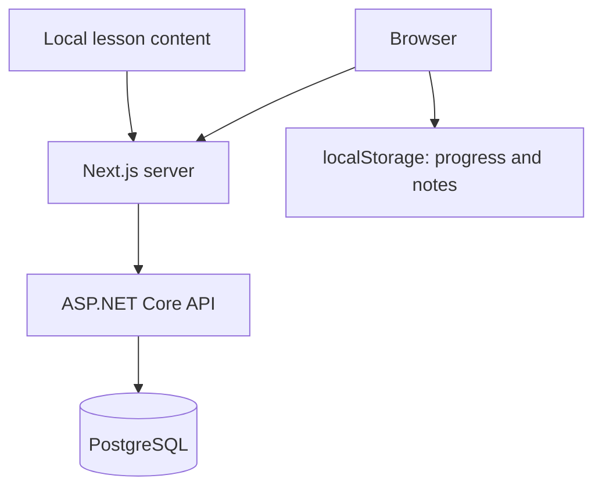

# SkillForge

[](https://github.com/AndriiVDO/skillforge/actions/workflows/ci.yml)

A personal learning workspace built with Next.js, ASP.NET Core, and PostgreSQL.

Explore technical topics, complete practical tasks, and keep personal learning notes.

## Features

- Learning dashboard with progress statistics
- Searchable topic catalog backed by an API
- Topic pages with task checklists and learning resources
- Personal notes saved separately for each topic
- System page showing API availability
- Loading states and retry handling
- Responsive dark interface

## Architecture



The Next.js server fetches topic summaries from the API.
The API reads these summaries from PostgreSQL through Entity Framework Core.

Lesson descriptions, checklists, resources, and topic metadata currently
remain in the frontend dataset.

Progress and personal notes are stored in the browser.

## Tech stack

| Area        | Technologies                                |
| ----------- | ------------------------------------------- |
| Frontend    | Next.js 16, React, TypeScript, Tailwind CSS |
| Backend     | C#, ASP.NET Core 10, Minimal APIs           |
| Database    | PostgreSQL 17, EF Core, Npgsql              |
| Development | Docker Compose, .NET User Secrets           |
| CI          | GitHub Actions, Python API checks           |

## Requirements

- Node.js 22 and npm
- .NET 10 SDK
- Docker Desktop with Docker Compose

The following commands assume PowerShell and the repository root.

## Local setup

### 1. Install dependencies

```powershell
npm ci
dotnet tool restore
dotnet restore backend/SkillForge.Api
```

### 2. Configure environment files

Copy the example configuration:

```powershell
Copy-Item .env.example .env.local
```

Ensure `.env.local` contains:

```dotenv
SKILLFORGE_API_URL=http://localhost:5050
```

Create `.env.database`:

```dotenv
POSTGRES_PASSWORD=replace_with_your_local_database_password
```

Use the same database password in the connection string below.

### 3. Configure the API connection

```powershell
dotnet user-secrets set "ConnectionStrings:SkillForge" "Host=localhost;Port=5433;Database=skillforge;Username=skillforge;Password=replace_with_your_local_database_password" --project backend/SkillForge.Api
```

### 4. Start PostgreSQL and apply migrations

```powershell
docker compose --env-file .env.database up -d --wait
$env:ASPNETCORE_ENVIRONMENT = "Development"
dotnet ef database update --project backend/SkillForge.Api
```

### 5. Start the backend

In the same terminal:

```powershell
dotnet run --project backend/SkillForge.Api --no-launch-profile --urls http://localhost:5050
```

### 6. Start the frontend

In another terminal:

```powershell
npm run dev
```

Open the frontend URL printed in the terminal, normally
http://localhost:3000.

## API endpoints

| Method | Endpoint             | Purpose                                  |
| ------ | -------------------- | ---------------------------------------- |
| GET    | `/api/health`        | API availability and runtime information |
| GET    | `/api/health/db`     | PostgreSQL connectivity                  |
| GET    | `/api/topics`        | Topic summaries                          |
| GET    | `/api/topics/{slug}` | One topic summary; 404 if absent         |

## Checks

Stop the development servers before building if files are locked.

```powershell
npx eslint .
npm run build
dotnet build backend/SkillForge.Api
dotnet list backend/SkillForge.Api package --vulnerable --include-transitive
```

GitHub Actions runs three jobs:

1. Frontend lint and production build.
2. Backend Release build.
3. API integration checks against a fresh PostgreSQL database.

The integration job applies migrations and checks database connectivity,
seeded topics, topic details, and the response for an unknown topic.

## Project structure

```text
.github/workflows/       CI configuration
backend/SkillForge.Api/  ASP.NET Core API, models, and migrations
scripts/                API integration check
src/app/                Next.js pages and routing
src/components/         Interface and interactive components
src/lib/                Topic content and API data loading
compose.yaml            Local PostgreSQL service
```

## Data persistence

PostgreSQL data is stored in a named Docker volume.
Stopping or recreating the container preserves that volume.

Browser progress and notes are specific to the browser and origin.
Clearing browser storage removes them.

## Current limitations

- Accounts and authentication are not implemented.
- Progress and notes do not sync across devices.
- Lesson content is still maintained in frontend source code.
- New database topics require matching local lesson content.
- The API currently supports reading topic summaries only.
- The System page reports API availability; database health has a separate endpoint.

## Roadmap

- [x] Build the learning dashboard and topic pages
- [x] Add browser-based progress and notes
- [x] Create an ASP.NET Core API
- [x] Store topic summaries in PostgreSQL
- [x] Connect the frontend catalog to the API
- [x] Add CI with PostgreSQL integration checks
- [ ] Move lesson content and resources into PostgreSQL
- [ ] Add topic creation and editing
- [ ] Add authentication and user-specific data
- [ ] Containerize the frontend and backend
- [ ] Publish a live demo

## Learning focus

This project explores frontend development, HTTP APIs, relational data,
database migrations, Docker, and continuous integration through practical work.
