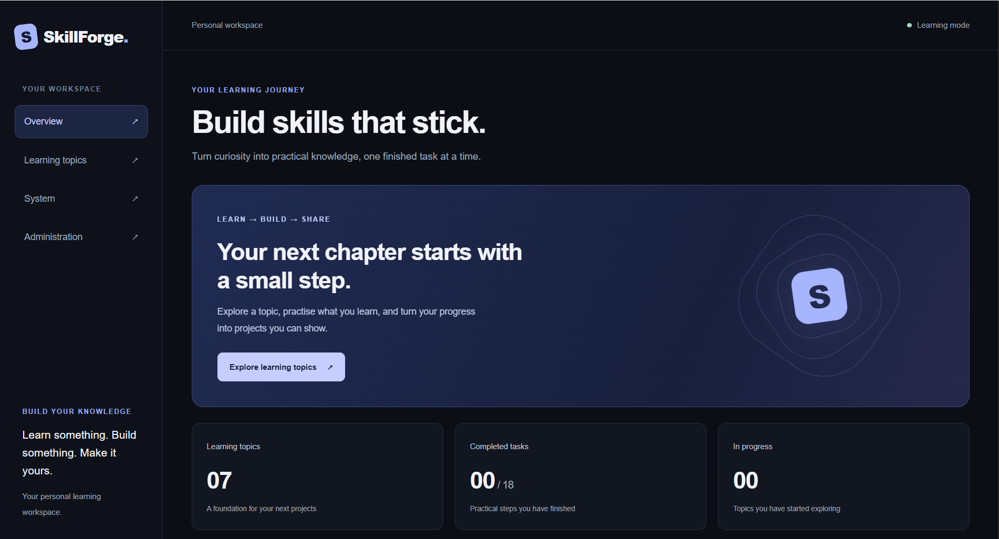
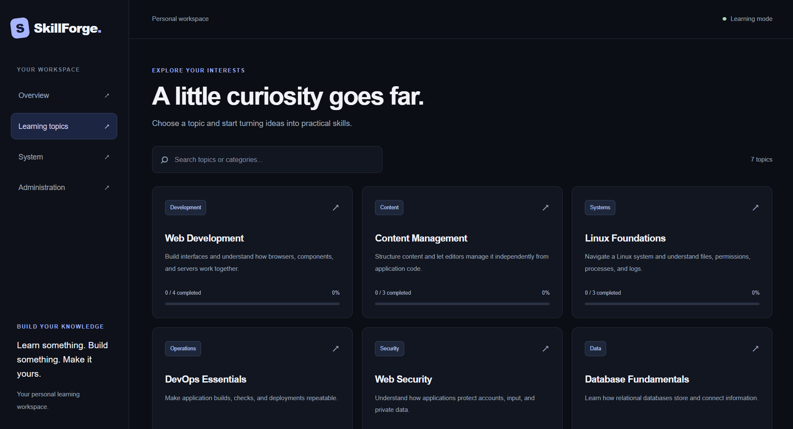
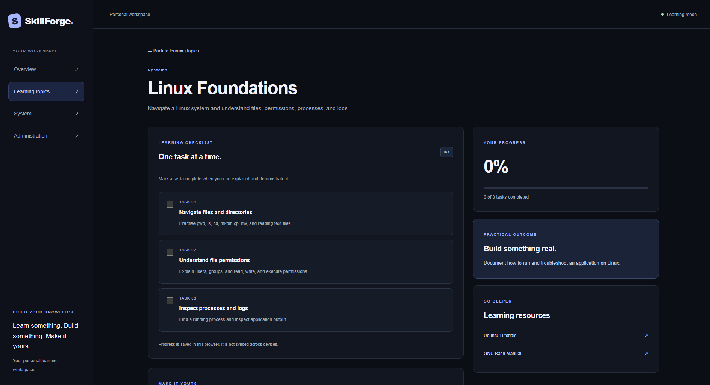
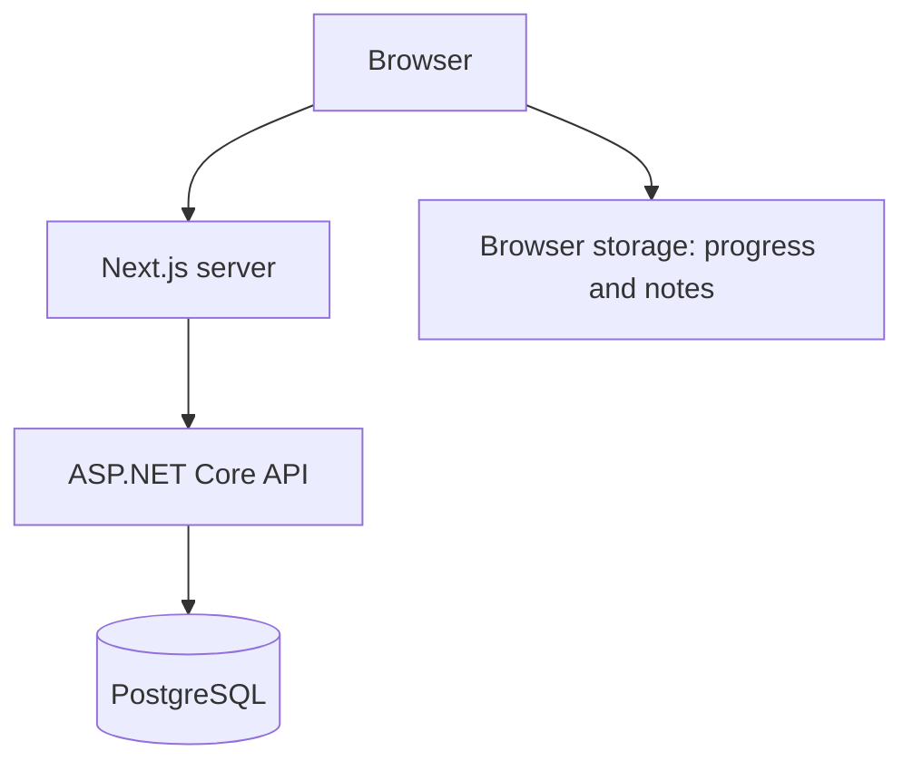

# SkillForge

[](https://github.com/AndriiVDO/skillforge/actions/workflows/ci.yml)

A personal learning workspace built with Next.js, ASP.NET Core, and PostgreSQL.

Explore technical topics, track practical tasks, and keep personal notes. Administrators can create and edit topics, add lessons, and manage learning resources.

## Features

- Learning dashboard with progress statistics
- Searchable topic catalog powered by PostgreSQL
- Topic pages with practical tasks and learning resources
- Per-topic notes and task progress saved in the browser
- Administrator sign-in and protected editing
- Topic creation and editing
- Forms for adding lessons and resources
- System page showing API availability
- Loading states, validation, and retry handling
- Responsive dark interface
- Docker Compose stack with automatic database migrations
- Automated build and integration checks
- Administrator forms for editing lessons and resources
- Explicit confirmation before deleting learning content
- Draft and published topics with administrator-only draft access

## Screenshots

### Learning dashboard



### Topic catalog



### Topic details



## Architecture



The Next.js server loads topics, lessons, and resources from the API.
Entity Framework Core manages database access and migrations.

Administrator authentication uses ASP.NET Core Identity. The Next.js
server stores the API access token in an HttpOnly cookie and attaches it
to protected API requests.

The API enforces the Admin policy on all content-writing endpoints.
Reading learning content is public.

Progress and personal notes remain in browser storage.

## Tech stack

| Area           | Technologies                                          |
| -------------- | ----------------------------------------------------- |
| Frontend       | Next.js 16, React, TypeScript, Tailwind CSS           |
| Backend        | C#, ASP.NET Core 10, Minimal APIs                     |
| Authentication | ASP.NET Core Identity, bearer tokens, HttpOnly cookie |
| Database       | PostgreSQL 17, Entity Framework Core, Npgsql          |
| Containers     | Docker, Docker Compose                                |
| Configuration  | Environment variables, .NET User Secrets              |
| CI             | GitHub Actions, Python integration checks             |

## Run with Docker

Docker Desktop with Docker Compose is required.
Run these commands in PowerShell from the repository root.

### 1. Create database configuration

Create `.env.database`:

```dotenv
POSTGRES_PASSWORD=replace_with_a_strong_local_password
```

This file contains a local secret and must remain outside version control.

### 2. Build and start the stack

```powershell
docker compose --env-file .env.database up -d --build
docker compose --env-file .env.database ps -a
```

Compose starts PostgreSQL, applies migrations, and starts the API and
frontend. The migration service exiting with code `0` means it succeeded.

| Service               | Address                             |
| --------------------- | ----------------------------------- |
| Frontend              | http://localhost:3000               |
| Administrator sign-in | http://localhost:3000/login         |
| API health            | http://localhost:5050/api/health    |
| Database health       | http://localhost:5050/api/health/db |

The public catalog works without an administrator account.
See administrator setup below to enable editing.

### 3. Stop the stack

```powershell
docker compose --env-file .env.database down
```

The database remains in its named volume. Adding `-v` removes that volume
and its data.

## Local development

Requirements:

- Node.js 22 and npm
- .NET 10 SDK
- Docker Desktop with Docker Compose

Stop any Docker frontend and API containers before starting local servers
on the same ports:

```powershell
docker compose --env-file .env.database stop frontend api
```

### 1. Install dependencies

```powershell
npm ci
dotnet tool restore
dotnet restore backend/SkillForge.Api
```

### 2. Configure the frontend

```powershell
Copy-Item .env.example .env.local
```

For local HTTP development, ensure `.env.local` contains:

```dotenv
SKILLFORGE_API_URL=http://localhost:5050
AUTH_COOKIE_SECURE=false
```

`SKILLFORGE_API_URL` is a server-side setting. In Docker, Compose points it
to the API service inside the container network.

### 3. Configure the database connection

Create `.env.database` as described above. Use the same password in the
API connection string:

```powershell
dotnet user-secrets set "ConnectionStrings:SkillForge" "Host=localhost;Port=5433;Database=skillforge;Username=skillforge;Password=replace_with_a_strong_local_password" --project backend/SkillForge.Api
```

User Secrets stores development configuration outside the repository.

### 4. Start PostgreSQL and apply migrations

```powershell
docker compose --env-file .env.database up -d --wait db
$env:ASPNETCORE_ENVIRONMENT = "Development"
dotnet ef database update --project backend/SkillForge.Api
```

### 5. Start the API

```powershell
$env:ASPNETCORE_ENVIRONMENT = "Development"
dotnet run --project backend/SkillForge.Api --no-launch-profile --urls http://localhost:5050
```

### 6. Start the frontend

In another terminal:

```powershell
npm run dev
```

Open http://localhost:3000.

## Administrator setup

There is no public registration endpoint. An administrator is created
explicitly using the provisioning command.

With the .NET SDK installed and the database running, configure
`ConnectionStrings:SkillForge` through User Secrets as described above.

Set the administrator email:

```powershell
dotnet user-secrets set "BootstrapAdmin:Email" "admin@example.com" --project backend/SkillForge.Api
```

Choose your own email and password. The email is an account identifier;
this step does not create an email mailbox.

The password must contain at least 12 characters, including uppercase
and lowercase letters, a digit, and a symbol.

Enter the password without placing it directly in command history:

```powershell
$adminPassword = Read-Host "Administrator password" -AsSecureString
try {
    $env:BootstrapAdmin__Password = [System.Net.NetworkCredential]::new("", $adminPassword).Password
    $env:ASPNETCORE_ENVIRONMENT = "Development"

    dotnet run --project backend/SkillForge.Api --no-launch-profile -- --CreateAdmin=true
}
finally {
    Remove-Item Env:BootstrapAdmin__Password -ErrorAction SilentlyContinue
    Remove-Variable adminPassword -ErrorAction SilentlyContinue
}
```

After successful provisioning, open `/login` and sign in.

An administrator created against the same PostgreSQL database is also
available when the application runs in Docker.

## API endpoints

| Method | Endpoint                                    | Access               | Purpose                                       |
| ------ | ------------------------------------------- | -------------------- | --------------------------------------------- |
| GET    | `/api/health`                               | Public               | API availability and runtime                  |
| GET    | `/api/health/db`                            | Public               | Database connectivity                         |
| GET    | `/api/topics`                               | Public               | Topics with lessons and resources             |
| GET    | `/api/topics/{slug}`                        | Public               | One topic, or HTTP 404                        |
| POST   | `/api/auth/login`                           | Public, rate limited | Administrator sign-in                         |
| GET    | `/api/auth/me`                              | Admin                | Current administrator identity                |
| POST   | `/api/topics`                               | Admin                | Create a topic                                |
| PUT    | `/api/topics/{slug}`                        | Admin                | Update a topic                                |
| POST   | `/api/topics/{slug}/lessons`                | Admin                | Add a lesson                                  |
| POST   | `/api/topics/{slug}/resources`              | Admin                | Add a resource                                |
| PUT    | `/api/topics/{slug}/lessons/{lessonId}`     | Admin                | Edit a lesson                                 |
| DELETE | `/api/topics/{slug}/lessons/{lessonId}`     | Admin                | Delete a lesson                               |
| PUT    | `/api/topics/{slug}/resources/{resourceId}` | Admin                | Edit a resource                               |
| DELETE | `/api/topics/{slug}/resources/{resourceId}` | Admin                | Delete a resource                             |
| DELETE | `/api/topics/{slug}`                        | Admin                | Delete a topic with its lessons and resources |
| PUT    | `/api/topics/{slug}/publication`            | Admin                | Publish a topic or move it to drafts          |

## Checks

```powershell
npx eslint .
npm run build
dotnet build backend/SkillForge.Api
dotnet list backend/SkillForge.Api package --vulnerable --include-transitive
```

GitHub Actions runs four jobs:

1. Frontend lint and production build.
2. Backend Release build.
3. PostgreSQL integration checks, including administrator provisioning,
   anonymous write rejection, and authenticated content writes.
4. Docker stack build and API/frontend smoke checks.

Integration checks use a fresh database and verify seeded content,
topic details, validation, persistence, and HTTP 404 responses.

## Project structure

| Path                      | Purpose                                               |
| ------------------------- | ----------------------------------------------------- |
| `.github/workflows/`      | Continuous integration                                |
| `backend/SkillForge.Api/` | API, authentication, models, and migrations           |
| `scripts/`                | API integration checks                                |
| `src/app/`                | Pages, routing, and Server Actions                    |
| `src/components/`         | Interface and interactive components                  |
| `src/lib/`                | API loading, types, and administrator session helpers |
| `Dockerfile`              | Frontend container build                              |
| `compose.yaml`            | Database, migration, API, and frontend services       |
| `.env.example`            | Example frontend configuration                        |

## Data and session behavior

- PostgreSQL stores topics, lessons, resources, and administrator accounts.
- Docker stores database data in a named volume.
- Progress and notes belong to the browser and origin. They do not sync
  across devices.
- Clearing browser storage removes local progress and notes.
- Administrator access tokens expire after 30 minutes.
- Signing out removes the browser session cookie.
- Docker persists API Data Protection keys in the `api_keys` volume,
  allowing unexpired administrator sessions to survive API container recreation.

## Deployment notes

The supplied Compose configuration is intended for local HTTP use and
sets `AUTH_COOKIE_SECURE=false`.

For an HTTPS deployment, set `AUTH_COOKIE_SECURE=true`, configure secret
delivery, and protect persisted Data Protection keys at rest.

## Operations guides

- [PostgreSQL backup and restore](docs/database-backup.md)

## Roadmap

- [x] Learning dashboard and topic pages
- [x] Browser-based progress and notes
- [x] ASP.NET Core API and PostgreSQL persistence
- [x] Database-backed lessons and resources
- [x] Topic creation and editing
- [x] Administrator authentication and protected writes
- [x] Containerized frontend and backend
- [x] CI with database integration and Docker smoke checks
- [x] Persist Data Protection keys across container recreation
- [ ] Synchronize user progress and notes across devices
- [x] Add lesson and resource editing and deletion
- [ ] Publish a live demo

## Learning focus

Built to practise frontend development, C#, HTTP APIs, relational data,
authentication, database migrations, containers, and continuous integration.
